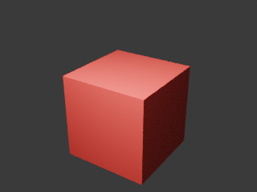

# Blender CLI：一键配置、macOS 实测与排错

此功能安装的是 [HKUDS/CLI-Anything 的 Blender harness](https://github.com/HKUDS/CLI-Anything/tree/34f519533bc175d2fe287ab8316b0dd99bb9cc43/blender/agent-harness)，通过 JSON 场景和 Blender Python 脚本工作。它不等于 Blender 本体，也不需要 Blender MCP 插件。

## 已验证环境

**测试日期：2026-10-18（Asia/Shanghai）。本机是 Mac，以下结果不能代表 Windows/Linux 实测。**

| 项目 | 本机版本或结果 |
| --- | --- |
| 系统 | macOS 15.7.4，build 24G517 |
| 架构 | Apple Silicon，arm64 |
| Python | Homebrew Python 3.14.7 |
| Blender | 5.2.0 LTS，build hash `fbe6228777e7` |
| Blender 路径 | `/Applications/Blender.app/Contents/MacOS/Blender` |
| CLI-Anything 固定提交 | `34f519533bc175d2fe287ab8316b0dd99bb9cc43` |
| CLI 包 | cli-anything-blender 1.0.0 |
| 依赖实测版本 | click 8.5.0、prompt_toolkit 3.0.53、wcwidth 0.9.2 |
| 输出 | Cycles，8 samples，320×240 PNG，红色立方体 |

源码提交固定；pip 依赖使用上游版本范围，具体安装版本写入每次结果文件。首次下载需要网络。macOS/Linux 安装脚本使用 POSIX 命令入口；Linux 尚未实机验证，Windows 会明确退出并提示不支持。

## 一键配置

先安装 [Blender](https://www.blender.org/download/)、Python 3.10+ 和 Git。在本仓库或已安装的 skill 目录执行：

```bash
python3 scripts/setup_blender.py
```

如果首次安装 Skill，可选 `python3 scripts/install.py --with-blender`。也可与 `--target claude`、`--target agents`、`--dest` 组合。Skill 已存在时安装器会保护旧目录；此时直接执行独立配置脚本。

脚本会识别 PATH 上的 `blender`，或 Mac 的 `/Applications/Blender.app`、`~/Applications/Blender.app`。其他位置用 `--blender "/绝对路径/Blender"` 指定可执行文件；不会下载或升级 Blender 本体。

配置会下载固定提交、在独立 venv 中安装 CLI、创建测试场景及材质/相机/灯光、生成渲染脚本、实际调用 Blender，再检查 PNG 标记和尺寸、记录 SHA-256。只有通过后才发布 `cli-anything-blender` 命令入口。现有非本工具管理的同名入口会受到保护。

```bash
source "$HOME/.local/share/tripo-3d/blender-cli/activate.sh"
cli-anything-blender --help
blender --version
```

`source` 对当前终端生效；脚本不自动修改 `.zshrc`。命令目录已在 PATH 时可直接使用 CLI。CLI 自己的入口也会带上内部 Blender 路径。

默认目录：

| 位置 | 用途 |
| --- | --- |
| `~/.local/share/tripo-3d/blender-cli/source/` | 固定提交的上游源码；不要手工修改 |
| 同目录 `venv/` | 独立 Python 环境 |
| 同目录 `bin/blender` | 指向本机可执行文件的受管理入口 |
| 同目录 `activate.sh` | 当前终端 PATH 配置 |
| 同目录 `checks/<时间戳>/` | JSON 场景、生成的 Python 渲染脚本、PNG |
| 同目录 `logs/<时间戳>.log` / `.json` | 每次完整命令日志与结果，包含失败记录 |
| 同目录 `setup-result.json` | 最近一次成功或失败的结果 |
| `~/.local/bin/cli-anything-blender` | 对外命令入口 |

需要卸载时，删除本工具创建的命令入口及运行环境目录即可；保留需要的测试图片后再删除。自定义路径用 `--home`、`--bin-dir`；路径包含中文和空格已验证。不要移动运行目录，入口使用绝对路径。

## 本次实际失败与对应修复

下表是本机实际复现，不把未发生的常见问题写成测试结果。旧教程命令仅用于说明失败原因，请使用最后一节的新命令。

| 失败操作/现象 | 实际错误或原因 | 已验证的解决办法 |
| --- | --- | --- |
| `blender --version` | 退出 127，`command not found: blender`；Mac 安装了 .app，但未加入 PATH | 自动识别应用内可执行文件；入口注入内部 PATH，source 后 `blender --version` 可用 |
| 在受限 Agent 环境拉取 GitHub | `Failed to connect to 127.0.0.1 port 7890`；该次执行无法连接本机配置的代理 | 使用允许访问网络和本机代理的执行环境后，同一 Git 操作成功；未更改全局代理配置 |
| `scene new --width 1920 --height 1080` | 退出 2，`No such option '--width'` | 改为 `--resolution-x 1920 --resolution-y 1080` |
| `object add -t cube --size 2` | 退出 2，`No such option '-t'` | 改为 `object add cube --param size=2` |
| `material create --color '#cc3333'` | 退出 1，`could not convert string to float` | 使用 0～1 的 RGBA，如 `0.8,0.05,0.05,1` |
| `scene info --project file.json` | 退出 2，`No such option '--project'` | 全局参数提前：`--project file.json scene info` |
| `render start --output image.png` | 退出 2，`No such command 'start'` | 改用 `render execute image.png` 生成脚本，再调用 Blender |
| `render execute` 成功却不能证明已有图片 | 当前上游只返回 `script_path` 等元数据，不启动 Blender | 配置脚本明确执行返回的脚本，要求 Blender 成功退出且新生成 PNG 尺寸正确 |
| 受限 Agent 环境执行真实渲染 | Blender 退出 `-11`（SIGSEGV），写出 `blender.crash.txt`，没有 PNG | 同一配置使用正常本机执行权限重跑 `--check` 后成功；崩溃根因尚未进一步定位，不断言是 Metal 或显卡问题 |
| 新增离线测试初次执行 | 系统版本查询使用 subprocess，影响 mock 断言；Mac 的 `/var` 与 `/private/var` 别名导致路径断言不一致 | 单独固定系统查询测试值，比较路径前统一 resolve；修正后 6 项新测试全部通过 |

`ARCH_CACHE_LINE_SIZE` 警告在成功与崩溃日志中都出现，不能单凭这条警告判断失败。成功渲染还出现 Blender 6.0 相关弃用警告，本次 5.2.0 渲染不受影响；没有验证未来 6.0 的兼容性。

缺少 Blender、Git、venv/pip，安装网络不通、入口冲突等其他情况，脚本会返回非零并给出日志位置。修复依赖或网络后重跑安装；仅复检已有环境用：

```bash
python3 scripts/setup_blender.py --check
```

自定义位置复检时重复指定相同路径参数。若在 Agent 沙箱中崩溃，可在自己的正常终端运行同一命令复检。不要将 CLI 帮助能打开、JSON 能写出或 Python 脚本已生成，单独视为渲染成功。

## 实际验收记录

- 默认用户目录全新安装：通过；`install.py --with-blender` 完整入口及已有环境重装：通过。
- 自定义中文/空格路径：安装及真实渲染通过；`--check` 在正常本机权限下通过。
- 独立 CLI 调用之间：场景、物体、材质持久化通过；真实 Cycles 渲染通过。
- 22 项原有离线自检 + 6 项新增失败路径测试：通过。
- 激活 PATH 后再次复检：通过；配置器跳过自己的 Blender 入口，避免入口指向自身。此风险由代码检查发现并修复，未作为实际 Blender 崩溃原因。
- 实际查看生成的 PNG：红色立方体可见，没有用缩略图替代渲染。
- 测试不访问 Tripo API、不读取 Tripo 密钥、不创建收费任务。



可分享的环境与失败证据见 [macOS 测试记录 JSON](blender-cli-macos-test.json)。本机完整日志留在安装目录，公开证据已去除个人绝对路径和运行环境变量。

## 当前版本可复现的命令

先 source 激活文件，再在自己的工作目录运行。每条独立命令都指向同一个场景文件，避免把内存状态当成已保存项目。材质与物体使用从 0 开始的索引。

```bash
cli-anything-blender --json scene new --name ProductShot \
  --resolution-x 320 --resolution-y 240 --engine CYCLES --samples 8 \
  --output productshot.json
cli-anything-blender --json --project productshot.json object add cube \
  --name ProductBox --param size=2
cli-anything-blender --json --project productshot.json material create \
  --name MatRed --color '0.8,0.05,0.05,1' --metallic 0.2
cli-anything-blender --json --project productshot.json material assign 0 0
cli-anything-blender --json --project productshot.json camera add \
  --location '4,-6,4' --rotation '63.4,0,33.7' --active
cli-anything-blender --json --project productshot.json light add area \
  --location '1,-3,5' --power 1000
cli-anything-blender --json --project productshot.json render settings --no-denoising
cli-anything-blender --json --project productshot.json scene info
cli-anything-blender --json --project productshot.json render execute product_render.png

# 上一步会在输出图片目录生成 _render_script.py；务必再实际执行它
blender --background --factory-startup --python-exit-code 1 --python "./_render_script.py"
```

默认 smoke test 用低采样、关闭降噪的 Cycles 配置检查基础链路；不代表已验证 Metal GPU 加速、复杂模型导入、动画或所有上游功能。`--factory-startup` 只用于该后台进程，不修改 Blender 用户首选项。

参考了用户提供的[博客园教程](https://www.cnblogs.com/fanshaoO/p/19751015)与截图；具体参数及“只生成脚本”的行为按[固定提交的命令实现](https://github.com/HKUDS/CLI-Anything/blob/34f519533bc175d2fe287ab8316b0dd99bb9cc43/blender/agent-harness/cli_anything/blender/blender_cli.py)和本机运行结果校正。没有照搬教程中的测试覆盖率或“安装后全局可用”等未经本机验证的结论。
